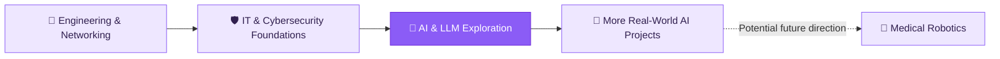

<!-- GitHub Profile README | Shahd Essam -->

<div align="center">


### Hi there, I'm Shahd! 👋 💜

**Final-Year Communication & Information Engineering Student**  
**Exploring AI, Large Language Models & Cybersecurity**

*Curious by nature. Engineer in progress. Always ready for a new adventure.* 🌍


</div>

---

## ✨ About Me

I'm **Shahd Essam**, a final-year **Communication and Information Engineering** student from Egypt. I love discovering how technology works, learning by building, and exploring new fields until I find the problems I care most about solving.

- 🤖 **Right now:** Diving deeper into **AI, Large Language Models (LLMs), model inference, and practical AI applications**.
- 🛡️ **My foundations:** Coursework in **CCNA/networking, AI, and introductory cybersecurity**.
- 🧰 **Industry exposure:** **Three IT training experiences** that helped me explore technical work beyond the classroom.
- 🦾 **A possible next chapter:** Considering a **master's degree in medical robotics**, where engineering and healthcare meet.
- 🌍 **Beyond the screen:** I love traveling, meeting people, trying new things, and learning about different cultures.
- 💜 **Fun fact:** Purple is my favorite color — so naturally, it belongs in my GitHub universe!

> **My mindset:** Learn widely, build practically, stay curious, and never stop exploring.

---

## 🧭 My Engineering Compass

| My foundation | My current focus | My curiosity for the future |
|:---:|:---:|:---:|
| 📡 **Networks & IT** | 🧠 **AI & LLMs** | 🦾 **Medical Robotics** |
| CCNA concepts, Linux, virtual labs, and introductory security | Pretrained models, inference, evaluation, prompt engineering, and AI applications | Exploring how intelligent systems can make a difference in healthcare |



---

## 🧰 Technical Toolbox

<div align="center">

**Programming & AI**


&nbsp;

&nbsp;


<br/><br/>

**Development & Systems**


</div>

| Area | Tools & concepts I've explored |
|---|---|
| **AI & LLMs** | Python, Hugging Face Transformers, pretrained models, inference pipelines, model evaluation, Gradio, prompting |
| **Networking** | CCNA fundamentals, TCP/IP, subnetting, routing, Cisco Packet Tracer, GNS3 |
| **Cybersecurity** | Introductory network security, security fundamentals, exploring offensive and defensive security |
| **Databases** | SQL and relational database fundamentals |
| **Development environment** | VS Code, Git, GitHub, Linux, virtual machines, Python virtual environments |

<sub>These are technologies I've studied or used, not a claim of expert-level proficiency in every tool.</sub>

---

## 🚀 Featured Work

### 🧠 [AI Model Inference & Evaluation — Week 2](https://github.com/shahd-essam27/week-2)

Hands-on Python labs and a mini-project exploring **pretrained AI models with Hugging Face**.

| What I built or explored | Key concepts |
|---|---|
| 🔎 Compared pretrained text summarization models | Model research and selection |
| 💬 Built sentiment-analysis inference functions | Transformers pipelines and reusable code |
| ⏱️ Benchmarked sentiment models | Accuracy, confidence, and latency |
| 🖥️ Created a Gradio sentiment-analysis interface | Interactive AI applications |
| 🌐 Built a language-detection model comparison project | Multilingual inference and model selection |

**Tech:** `Python` · `Hugging Face Transformers` · `Gradio` · `Jupyter Notebook`

[**Explore the repository →**](https://github.com/shahd-essam27/week-2)

### 🔬 Currently Exploring: LLM Engineering

My current learning direction includes:

- Calling hosted LLM APIs and understanding model parameters
- Prompt engineering and few-shot prompting
- Structured JSON outputs and validation
- Prompt-injection awareness and safer application design
- Building more practical AI projects to document on GitHub

*More projects will appear here as I build, test, and publish them.*

---

## 🎓 Education & Experience

**🎓 B.Sc. in Communication & Information Engineering — Final Year**  
Building a foundation across communications, networks, programming, and intelligent technologies.

**💼 IT Training — 3 Experiences**  
Exposure to IT environments and technical learning through three training experiences.

**📚 Additional Coursework**  
CCNA / Networking · Artificial Intelligence · Introductory Cybersecurity

---

## 🎯 My Learning Roadmap

| Now 🧠 | Next 🚀 | Exploring 🔭 |
|---|---|---|
| Deepen AI and LLM understanding | Build and publish more end-to-end AI projects | Graduate study options in medical robotics |
| Practice prompt engineering and evaluation | Strengthen practical ML/AI engineering skills | AI applications in healthcare |
| Document experiments and lessons on GitHub | Revisit cybersecurity through practical projects | Interdisciplinary engineering research |

---

## 📊 GitHub Activity

<div align="center">


<sub>GitHub language statistics reflect public repository content, not overall proficiency.</sub>

</div>

---

## 🌸 A Little More About Me

```python
shahd = {
    "name": "Shahd Essam",
    "studying": "Communication & Information Engineering",
    "current_focus": ["AI", "LLMs", "Practical Projects"],
    "exploring_next": ["Cybersecurity", "Medical Robotics"],
    "loves": ["Travel", "New Cultures", "Meeting People", "Learning"],
    "favorite_color": "Purple 💜",
    "motto": "Stay curious, keep building!"
}
```

---

## 🤝 Let's Connect

I'm always interested in **learning opportunities, interesting engineering projects, AI experiments, and exchanging ideas** with curious people.

<div align="center">

[](https://github.com/shahd-essam27)

**Thanks for visiting my little corner of GitHub! 💜**

*Learning something new, one project at a time.*


</div>
